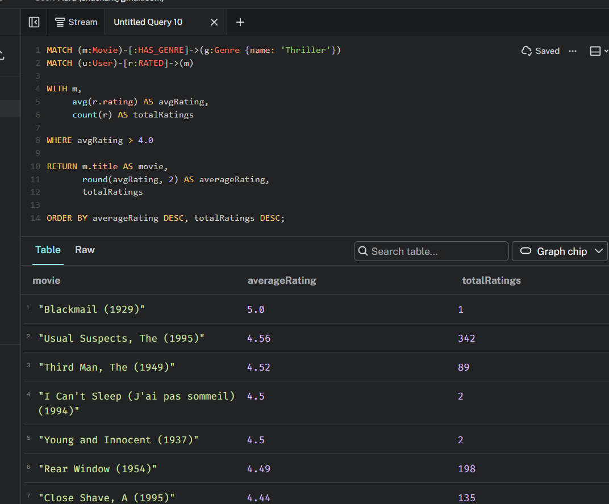
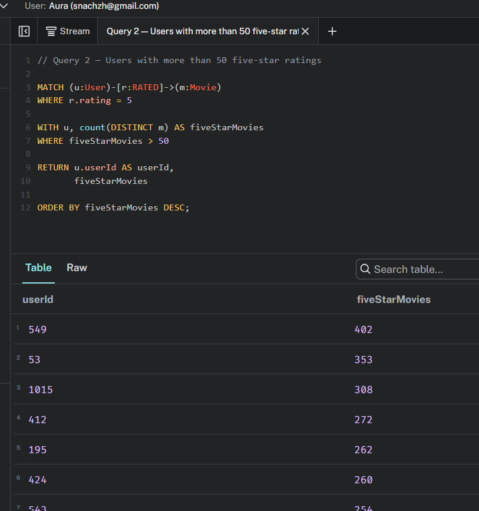
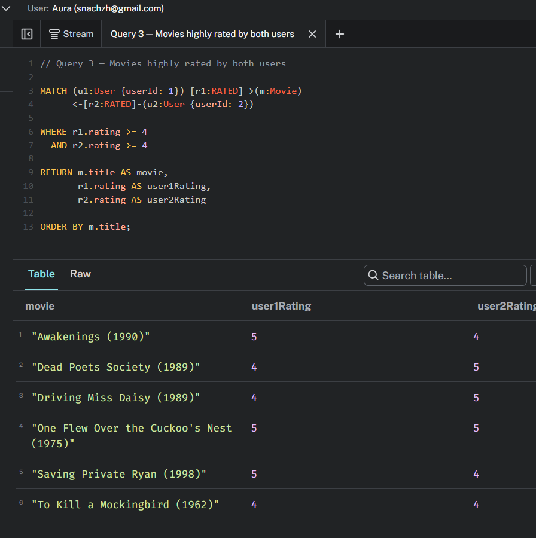
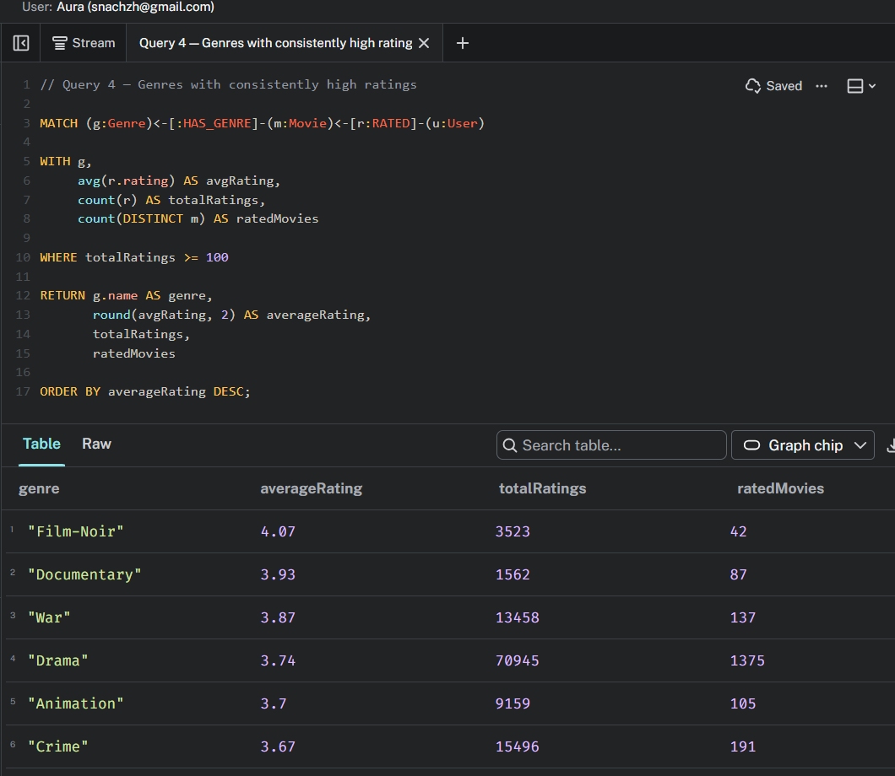
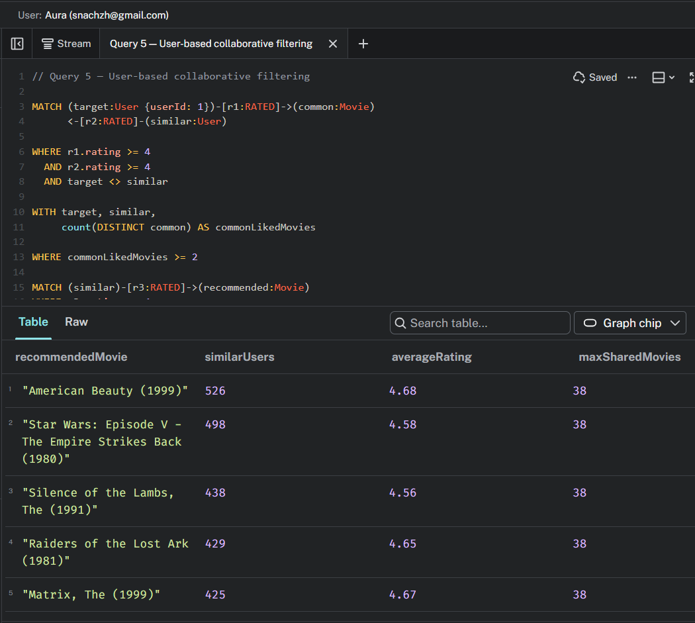
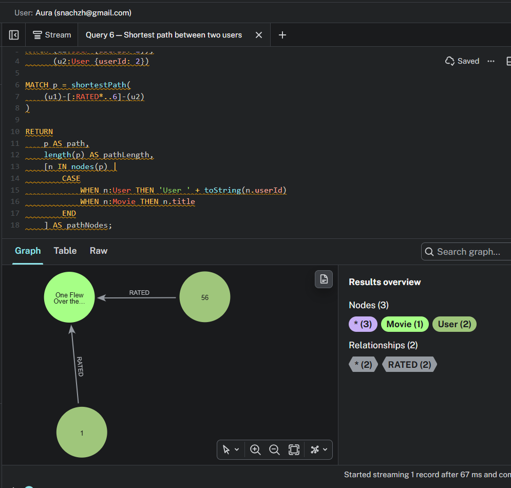

# NoSQL Homework 3 — MovieLens Knowledge Graph

## Project Overview

This project implements a graph-based movie recommendation system using **Neo4j AuraDB Free** and the **MovieLens 1M** dataset.

The objective is to explore graph data modeling, Cypher queries, recommendation patterns, shortest paths, and supernode detection.

The project covers:

- Graph schema design and relationship modeling.
- Importing MovieLens data into Neo4j AuraDB.
- Creating uniqueness constraints and indexes.
- Writing Cypher queries for analysis and recommendations.
- Detecting high-degree nodes (supernodes).
- Comparing graph databases with relational databases.

**Dataset:** [MovieLens 1M](https://grouplens.org/datasets/movielens/1m/)

**Database:** Neo4j AuraDB Free

**Language:** Cypher 25

**Environment:** Python, VS Code, Neo4j Aura Query

---

## Part 1 — Graph Schema Design

### 1.1 Graph Schema

The graph contains three node types and two relationship types.

```text
(User {userId, gender, age, occupation})
   |
   | RATED {rating, timestamp}
   v
(Movie {movieId, title, year})
   |
   | HAS_GENRE
   v
(Genre {name})
```

### 1.2 Nodes

| Node | Properties | Description |
|---|---|---|
| User | userId, gender, age, occupation | Represents a MovieLens user |
| Movie | movieId, title, year | Represents a movie |
| Genre | name | Represents a movie genre |

### 1.3 Relationships

| Relationship | Direction | Properties | Description |
|---|---|---|---|
| RATED | User → Movie | rating, timestamp | Stores a user's rating of a movie |
| HAS_GENRE | Movie → Genre | — | Connects movies with their genres |

### 1.4 Design Decisions

**Q1. Why are users, movies, and genres modeled as nodes?**

Users, movies, and genres are independent entities that participate in multiple relationships. Representing them as nodes enables efficient traversal of user preferences, movie similarities, and genre connections.

**Q2. Why is a rating modeled as a relationship instead of a separate node?**

A rating represents an interaction between one user and one movie. Storing its score and timestamp as properties of the `RATED` relationship simplifies recommendation queries and reduces the number of graph elements.

A separate `Rating` node would be more appropriate if ratings required additional relationships, detailed histories, or independent lifecycle management.

**Q3. Why are genres modeled as separate nodes instead of a list property?**

Separate `Genre` nodes allow movies to share the same genre entity. This makes genre-based traversals, recommendations, and analysis more natural.

A genre list would be simpler for basic filtering, but less convenient when genres participate in graph relationships.

---

## Part 2 — Data Preparation and Loading

### 2.1 Data Preparation

The MovieLens 1M dataset contains:

- 6,040 users.
- 3,883 movies.
- 1,000,209 ratings.

The original `.dat` files use `::` as a delimiter and Latin-1 encoding.

The `convert.py` script converts the files to UTF-8 CSV format for Neo4j ingestion.

### 2.2 Database Configuration

The project uses **Neo4j AuraDB Free**, avoiding the need for a locally managed Neo4j server.

Connection and APOC availability were verified successfully.

| Check | Result |
|---|---|
| AuraDB connection | Successful |
| APOC version | 2026.10.2 |
| `apoc.periodic.iterate` | Available |

### 2.3 Constraints and Indexes

Three uniqueness constraints were created before data ingestion.

| Constraint | Node | Property |
|---|---|---|
| user_id_unique | User | userId |
| movie_id_unique | Movie | movieId |
| genre_name_unique | Genre | name |

These constraints prevent duplicate identifiers and automatically create indexes used to locate nodes during `MERGE` and relationship creation.

All three constraints were successfully verified using `SHOW CONSTRAINTS`.

Implementation: `queries/part2_load.cypher`.

### 2.4 Execution Evidence

Add a screenshot of the successfully created constraints:


### 2.5 Data Import Results

The MovieLens 1M dataset was successfully imported into Neo4j AuraDB Free using Cypher `LOAD CSV` queries with CSV files accessible via GitHub Raw URLs.

Uniqueness constraints were created before loading data. `MERGE` was used to prevent duplicate nodes and relationships during repeated executions.

The `RATED` relationships were imported in batches using `apoc.periodic.iterate` with a batch size of 1,000 and sequential execution (`parallel: false`).

Due to the resource limitations of AuraDB Free, the import was limited to the first 200,000 ratings.

| Element | Imported count |
|---|---:|
| User nodes | 6,040 |
| Movie nodes | 3,883 |
| Genre nodes | 18 |
| RATED relationships | 200,000 |
| HAS_GENRE relationships | 6,408 |
| **Total nodes** | **9,941** |
| **Total relationships** | **206,408** |

The final relationship counts were verified using Cypher aggregation queries.

## Part 3 — Cypher Queries

**Implementation:** [queries/part3.cypher](queries/part3.cypher)

This section demonstrates six Cypher queries of increasing complexity using the MovieLens knowledge graph. The queries cover filtering, aggregation, shared preferences, collaborative filtering, and shortest-path analysis.

The analysis is based on a subset of 200,000 ratings from the MovieLens 1M dataset.

### Query 1 — Thriller Movies with Average Rating Above 4.0

**Purpose:** Identify Thriller movies whose average user rating exceeds 4.0.

**Logic:** Traverse `HAS_GENRE` and `RATED` relationships, calculate the average rating and number of ratings per movie, filter results above 4.0, and sort by average rating.

**Results:**

| Movie | Average rating | Total ratings |
|---|---:|---:|
| Blackmail (1929) | 5.00 | 1 |
| The Usual Suspects (1995) | 4.56 | 342 |
| The Third Man (1949) | 4.52 | 89 |
| Rear Window (1954) | 4.49 | 198 |

**Interpretation:** A high average rating does not necessarily indicate a reliable recommendation. Blackmail has a perfect score based on only one rating, whereas The Usual Suspects has a high average supported by hundreds of ratings.



### Query 2 — Users with More Than 50 Five-Star Ratings

**Purpose:** Identify users who gave a rating of 5 to more than 50 distinct movies.

**Logic:** Filter `RATED` relationships with a rating of 5, count distinct movies per user, and return users exceeding the threshold.

**Results:**

| User ID | Five-star movies |
|---|---:|
| 549 | 402 |
| 53 | 353 |
| 1015 | 308 |
| 412 | 272 |
| 195 | 262 |

**Interpretation:** Some users are substantially more active in assigning maximum ratings. User 549 gave 402 five-star ratings, making this user an interesting candidate for further analysis of graph connectivity.



### Query 3 — Movies Highly Rated by Two Users

**Purpose:** Find movies that both User 1 and User 2 rated at least 4.

**Logic:** Match the pattern `User → Movie ← User` and filter both relationship ratings to be at least 4.

**Results:** Six movies satisfy the condition, including:

- Awakenings (1990)
- Dead Poets Society (1989)
- Driving Miss Daisy (1989)
- One Flew Over the Cuckoo's Nest (1975)
- Saving Private Ryan (1998)
- To Kill a Mockingbird (1962)

**Interpretation:** The shared movie connections demonstrate overlapping user preferences. Such patterns form the basis for graph-based collaborative recommendation systems.



### Query 4 — Genres with High Average Ratings

**Purpose:** Compare movie genres using their average rating, total number of ratings, and number of rated movies.

**Logic:** Traverse `User → Movie → Genre`, aggregate rating information by genre, and exclude genres with fewer than 100 ratings.

**Results:**

| Genre | Average rating | Total ratings |
|---|---:|---:|
| Film-Noir | 4.07 | 3,523 |
| Documentary | 3.93 | 1,562 |
| War | 3.87 | 13,458 |
| Drama | 3.74 | 70,945 |
| Animation | 3.70 | 9,159 |
| Crime | 3.67 | 15,496 |

**Interpretation:** Film-Noir has the highest average rating among the displayed genres, while Drama has substantially more ratings. Average rating and rating volume measure different aspects of user preferences. Ratings of movies belonging to multiple genres contribute to each applicable genre.



### Query 5 — User-Based Collaborative Filtering

**Purpose:** Recommend movies to User 1 based on other users with similar preferences.

**Logic:** Identify users who share at least two highly rated movies with the target user, find additional movies those users rated highly, and exclude movies already rated by the target user. Rank candidates by the number of similar users supporting each recommendation.

**Results:**

| Recommended movie | Similar users | Average rating |
|---|---:|---:|
| American Beauty (1999) | 526 | 4.68 |
| Star Wars: Episode V — The Empire Strikes Back (1980) | 498 | 4.58 |
| The Silence of the Lambs (1991) | 438 | 4.56 |
| Raiders of the Lost Ark (1981) | 429 | 4.65 |
| The Matrix (1999) | 425 | 4.67 |

**Interpretation:** The graph supports collaborative filtering by identifying shared preferences through multi-hop relationships. The approach generates recommendations without training a machine-learning model, although popular movies may receive disproportionate support.



### Query 6 — Shortest Path Between Two Users

**Purpose:** Find the shortest connection between User 1 and User 2 through movies they have rated.

**Logic:** Search for the shortest path using undirected traversal over `RATED` relationships, allowing at most six hops.

**Results:** The query returned a path containing three nodes and two `RATED` relationships, with a path length of 2.

**Interpretation:**

- **Path length 2:** Two users rated the same movie.
- **Path length 4:** Two users are connected through one intermediate user and two movies.
- **Path length 6:** Two users are connected through two intermediate users and three movies.

A hop represents traversal of one relationship. The shortest path is measured in relationships, not in the number of movies or users alone.

The shortest path is calculated using graph connectivity, regardless of the actual rating values. Therefore, two users connected through a movie do not necessarily have similar preferences.



### Part 3 Conclusion

The six queries demonstrate how Cypher expresses relationships directly through graph patterns. Simple aggregation queries resemble SQL operations, while shared-preference, recommendation, and shortest-path queries benefit from the graph model's explicit relationships.

All results reflect the imported subset of 200,000 ratings and should not be interpreted as statistics for the entire MovieLens 1M dataset.

### Shortest Path Interpretation

**1. What does path length mean in this graph?**

Path length represents the number of relationships (hops) traversed between two users. In our graph, users are connected to movies through `RATED` relationships. Therefore, the shortest path measures how many relationships are needed to connect two users through movies they have rated.

**2. What does a path length of 2 mean?**

A path length of 2 indicates that two users rated at least one common movie.

Example:

`User 1 → Movie A ← User 2`

The query between User 1 and User 2 returned a shortest path length of 2, demonstrating that they share a rated movie.

**3. How should paths of length 4 and 6 be interpreted?**

A path length of 4 means two users are connected through one intermediate user and two movies.

`User 1 → Movie A ← User 3 → Movie B ← User 2`

A path length of 6 means two users are connected through two intermediate users and three movies.

`User 1 → Movie A ← User 3 → Movie B ← User 4 → Movie C ← User 2`

Longer paths indicate more indirect connections between users. However, path length alone does not measure preference similarity because `RATED` relationships may represent positive or negative ratings.

## Part 4 — Supernode Detection

*To be completed after measuring node degrees and analyzing supernodes.*

## Part 5 — Graph Data Science (Optional)

*Optional: PageRank, Louvain, and Dijkstra.*

## Part 6 — Analysis and Conclusions

*To be completed using the actual query results and graph performance observations.*