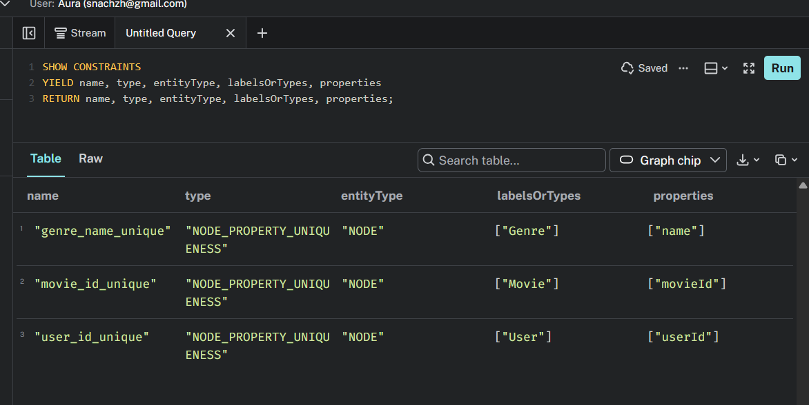

# NoSQL Homework 3 — MovieLens Knowledge Graph

## Project Overview

This project implements a graph-based movie recommendation system using **Neo4j AuraDB Free** and the **MovieLens 1M** dataset.

The objective is to explore graph data modeling, Cypher queries, recommendation patterns, shortest paths, and supernode detection.

The project covers:

- Graph schema design and relationship modeling.
- Importing MovieLens data into Neo4j AuraDB.
- Creating uniqueness constraints and indexes.
- Writing Cypher queries for analysis and recommendations.
- Detecting high-degree nodes (supernodes).
- Comparing graph databases with relational databases.

**Dataset:** [MovieLens 1M](https://grouplens.org/datasets/movielens/1m/)

**Database:** Neo4j AuraDB Free

**Language:** Cypher 25

**Environment:** Python, VS Code, Neo4j Aura Query

---

## Part 1 — Graph Schema Design

### 1.1 Graph Schema

The graph contains three node types and two relationship types.

```text
(User {userId, gender, age, occupation})
   |
   | RATED {rating, timestamp}
   v
(Movie {movieId, title, year})
   |
   | HAS_GENRE
   v
(Genre {name})
```

### 1.2 Nodes

| Node | Properties | Description |
|---|---|---|
| User | userId, gender, age, occupation | Represents a MovieLens user |
| Movie | movieId, title, year | Represents a movie |
| Genre | name | Represents a movie genre |

### 1.3 Relationships

| Relationship | Direction | Properties | Description |
|---|---|---|---|
| RATED | User → Movie | rating, timestamp | Stores a user's rating of a movie |
| HAS_GENRE | Movie → Genre | — | Connects movies with their genres |

### 1.4 Design Decisions

**Q1. Why are users, movies, and genres modeled as nodes?**

Users, movies, and genres are independent entities that participate in multiple relationships. Representing them as nodes enables efficient traversal of user preferences, movie similarities, and genre connections.

**Q2. Why is a rating modeled as a relationship instead of a separate node?**

A rating represents an interaction between one user and one movie. Storing its score and timestamp as properties of the `RATED` relationship simplifies recommendation queries and reduces the number of graph elements.

A separate `Rating` node would be more appropriate if ratings required additional relationships, detailed histories, or independent lifecycle management.

**Q3. Why are genres modeled as separate nodes instead of a list property?**

Separate `Genre` nodes allow movies to share the same genre entity. This makes genre-based traversals, recommendations, and analysis more natural.

A genre list would be simpler for basic filtering, but less convenient when genres participate in graph relationships.

---

## Part 2 — Data Preparation and Loading

### 2.1 Data Preparation

The MovieLens 1M dataset contains:

- 6,040 users.
- 3,883 movies.
- 1,000,209 ratings.

The original `.dat` files use `::` as a delimiter and Latin-1 encoding.

The `convert.py` script converts the files to UTF-8 CSV format for Neo4j ingestion.

### 2.2 Database Configuration

The project uses **Neo4j AuraDB Free**, avoiding the need for a locally managed Neo4j server.

Connection and APOC availability were verified successfully.

| Check | Result |
|---|---|
| AuraDB connection | Successful |
| APOC version | 2026.10.2 |
| `apoc.periodic.iterate` | Available |

### 2.3 Constraints and Indexes

Three uniqueness constraints were created before data ingestion.

| Constraint | Node | Property |
|---|---|---|
| user_id_unique | User | userId |
| movie_id_unique | Movie | movieId |
| genre_name_unique | Genre | name |

These constraints prevent duplicate identifiers and automatically create indexes used to locate nodes during `MERGE` and relationship creation.

All three constraints were successfully verified using `SHOW CONSTRAINTS`.

Implementation: `queries/part2_load.cypher`.

### 2.4 Execution Evidence

Add a screenshot of the successfully created constraints:



### 2.5 Data Import Results

The MovieLens 1M dataset was successfully imported into Neo4j AuraDB Free using Cypher `LOAD CSV` queries with CSV files accessible via GitHub Raw URLs.

Uniqueness constraints were created before loading data. `MERGE` was used to prevent duplicate nodes and relationships during repeated executions.

The `RATED` relationships were imported in batches using `apoc.periodic.iterate` with a batch size of 1,000 and sequential execution (`parallel: false`).

Due to the resource limitations of AuraDB Free, the import was limited to the first 200,000 ratings.

| Element | Imported count |
|---|---:|
| User nodes | 6,040 |
| Movie nodes | 3,883 |
| Genre nodes | 18 |
| RATED relationships | 200,000 |
| HAS_GENRE relationships | 6,408 |
| **Total nodes** | **9,941** |
| **Total relationships** | **206,408** |

The final relationship counts were verified using Cypher aggregation queries.

## Part 3 — Cypher Queries

*To be completed after running all six required queries.*

## Part 4 — Supernode Detection

*To be completed after measuring node degrees and analyzing supernodes.*

## Part 5 — Graph Data Science (Optional)

*Optional: PageRank, Louvain, and Dijkstra.*

## Part 6 — Analysis and Conclusions

*To be completed using the actual query results and graph performance observations.*